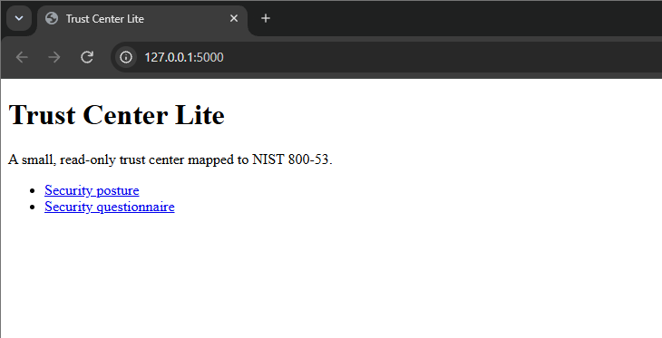
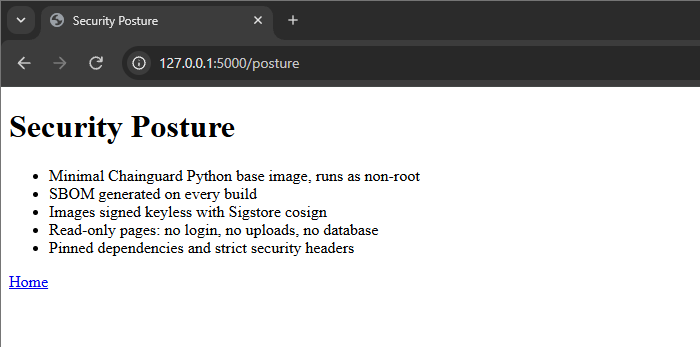
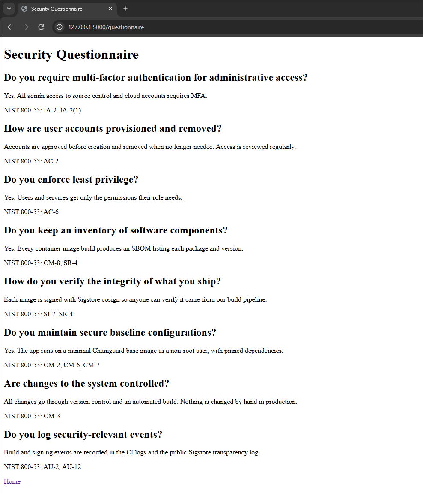

Trust Center Lite is a mini security trust center like the ones companies publish for customers. Screenshots of the live pages are below.

\# Trust Center Lite

A small, read-only trust center written in Flask. It shows a security posture page and a security questionnaire, with each answer mapped to NIST 800-53 controls.

\## How it's built

\- Runs on the minimal `cgr.dev/chainguard/python` image as a non-root user, served by gunicorn

\- Read-only pages: no login, no uploads, no database

\- Pinned dependencies and strict security headers (CSP, nosniff, X-Frame-Options, Referrer-Policy, HSTS)

\- A GitHub Actions pipeline builds the image, generates an SPDX SBOM, and signs the image keyless with Sigstore cosign

\## Verify the signature

cosign verify ghcr.io/cloudveteran/trust-center-lite:latest \\

&#x20; --certificate-identity-regexp "https://github.com/CloudVeteran/trust-center-lite/.\*" \\

&#x20; --certificate-oidc-issuer https://token.actions.githubusercontent.com

\## Status

On the Chainguard Harness beta waitlist (Nov 2026). Scan pending.

